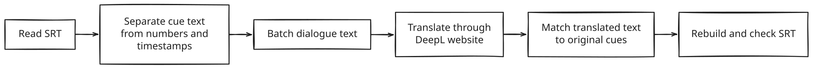

# Case study on a better DeepL SRT translator

**People:** slappepolsen and twinkgenius (Atlas)  
**Keywords:** SRT, DeepL, Playwright, browser automation, batching, Python

## Result

We developed **Better DST** (Better DeepL SRT Translator), a Python script that translates `.srt` subtitles through DeepL's website rather than its API. The main engineering challenge turned out to be more about **cue integrity**. Because DeepL can merge lines, remove separators, wrap text in quotation marks or return an incomplete batch. It can hallicunate like a typical LLM. A translation can read correctly while being assigned to the wrong subtitle.

> ***Better DST automates DeepL's web interface using Playwright, without directly calling the official DeepL API or requiring an API key.***

The v0.1.11 implementation uses numbered cue markers, per-cue line handling, retries and a final 1:1 check of subtitle numbers and timestamps. It improves structural reliability. It does not guarantee translation accuracy or that every cue was translated successfully.

## 1. Starting point

The project grew out of repeated problems translating large collections of subtitles. In our earlier workflow, Gemini-based translation could hit quotas, return the wrong number of lines or fail on overloaded requests. We also tested locally hosted alternatives, including LibreTranslate and LTEngine. Those were viable to run locally, but the translations we sampled were often too literal and lost conversational nuance.

We wanted to use DeepL's existing web translator without building the project around another paid API. The question was whether we could automate its frontend **without corrupting the original SRT structure**.

## 2. Initial implementation

The first standalone prototype used Python and Playwright to interact with DeepL in a Chromium browser. Its pipeline was straightforward.

Only dialogue text was sent for translation. Cue numbers and timestamps stayed local and were restored when writing the output file. Batching was necessary to process longer subtitle files without pasting the entire file at once.

The early versions used `---` between cues and `⟦lb⟧` to represent line breaks inside a cue. In practice, DeepL sometimes altered these separators, merged separate cues or produced punctuation-only lines. Splitting its response by line count could silently assign dialogue to the wrong subtitle.

## 3. What we changed

**Cue identity.** We replaced the ambiguous `---` separators with explicit `[[DST_N]]` markers, where `N` identifies the original subtitle cue. The decoder rejects missing, duplicate or unexpected markers instead of guessing which translation belongs where.

**Multi-line cues.** Atlas suggested joining the lines of a two-line cue with `🥕` before translation, then splitting the returned text on that marker. Single-line cues do not need it. When a translation no longer matches the expected line structure, the script attempts recovery rather than blindly accepting the result.

**Recovery.** On a batch mismatch, the translator splits the batch and retries smaller groups, eventually retrying an individual cue. If a cue still cannot be reconstructed, the current implementation can keep its original text and log a warning. This prevents some structural corruption but means the final file may contain untranslated dialogue.

**Browser reliability.** DeepL's frontend changed during development. The language picker intermittently failed, and later revisions accidentally disrupted translation by clearing the target panel. v0.1.11 restored the previously working language-selection approach, writes only to the source panel and waits for the exact expected cue markers before accepting a translated response.

**Output checks.** Before writing the result, the script verifies that the output contains the same number of cues, with the same cue numbers and timestamps as the source. Text post-processing also handles unwanted wrapping quotes, dialogue dashes, punctuation and uneven line lengths.

## 4. Version progression

- **v0.1.2–v0.1.4:** Cookie handling, language selection, line-break preservation, empty-cue retries and initial formatting fixes.
- **v0.1.5–v0.1.6:** Code cleanup, stricter SRT parsing and numbered batch markers to replace ambiguous separators.
- **v0.1.7:** More explicit cue mapping and Atlas's `🥕` approach for multi-line cues, plus additional validation and retry behavior.
- **v0.1.8:** Experimented with a modular structure (`srt`, `codec` and `browser`) and improved quote handling and cue mapping.
- **v0.1.9–v0.1.10:** Browser-layer changes introduced regressions in language selection and translation.
- **v0.1.11:** Returned to the working browser interaction from v0.1.3 while retaining later cue-integrity improvements in a standalone script.

For individual changes, see the [changelog](https://github.com/slappepolsen/better-dst/blob/main/CHANGELOG.md).

## 5. Current workflow

With Playwright and its Chromium browser installed, the script takes an input `.srt`, divides it into batches subject to character and cue limits, sends each batch through DeepL's website, validates the returned cue markers and reconstructs the subtitle file. The example below is run from the [source repository](https://github.com/slappepolsen/better-dst/), since scripts are not included in this case study.

```bash
python3 better_dst.py subs.srt --target en
```

The default output filename in this example is `subs.en.srt`. For the current source code, installation instructions, supported languages and troubleshooting, see the [Better DST repository](https://github.com/slappepolsen/better-dst/).

### Workflow diagram



## 6. Outcome and limits

The result is a repeatable browser-based translation workflow that preserves the source SRT's cue count, numbering and timestamps while detecting many of the formatting failures observed during development. It does not use the DeepL API or require an API key.

There are still important limits:

- Structural checks do not establish that a translation is semantically correct or that its dialogue is assigned correctly when DeepL changes meaning without changing markers.
- Some failed single-cue translations can fall back to the original text with a warning. A structurally valid output is therefore not proof that every cue was translated.
- Results are written at the end of a run. An interrupted run does not currently support resuming from the last completed batch.
- The script depends on DeepL's website remaining compatible with its browser interactions. UI changes, rate limits or automated-access checks can interrupt runs; a Cloudflare block was observed during development.

This case study describes our implementation and observed behavior, not a controlled benchmark of translation quality or throughput. Use of DeepL's website remains subject to the service's applicable terms and access restrictions.
